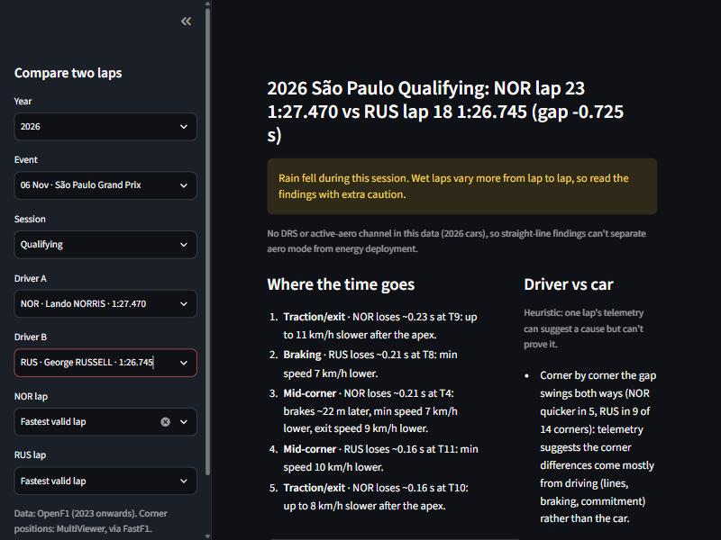

# Project Versailles: F1 qualifying telemetry analyser

Compares two drivers' qualifying laps from real F1 telemetry and shows **where** one gains or loses time and the **likely reason**, corner by corner.

**Live app: https://project-versailles.streamlit.app/** (any session from 2023 onwards; the app sleeps when unused, so the first visit can take a minute)



## Example: Norris vs Russell, 2026 São Paulo Grand Prix qualifying

Russell 1:26.745 (lap 18), Norris 1:27.470 (lap 23). Rain fell during the session.

```
1. [Traction/exit] NOR loses ~0.23 s at T9: up to 11 km/h slower after the apex.
2. [Braking]       RUS loses ~0.21 s at T8: min speed 7 km/h lower.
3. [Mid-corner]    NOR loses ~0.21 s at T4: brakes ~22 m later, min speed 7 km/h lower, exit speed 9 km/h lower.
4. [Mid-corner]    RUS loses ~0.16 s at T11: min speed 10 km/h lower.
5. [Traction/exit] NOR loses ~0.16 s at T10: up to 8 km/h slower after the apex.

Driver vs car (heuristic): the gap swings both ways corner by corner (NOR quicker in 5,
RUS in 9 of 14), which suggests driving differences rather than the car.
```

Speed (with corner numbers), time gap, throttle, brake and gear share one lap-distance axis, so zooming any of them zooms all five:


A track map colours 25 mini-sectors by the faster driver. Each finding is reproducible from the terminal: `python analysis.py 2026 Brazil Qualifying NOR RUS`.

## Method

1. **Data.** Lap times, car telemetry (speed, throttle, brake, gear, RPM at ~4 Hz) and car position come from [OpenF1](https://openf1.org). Corner positions come from MultiViewer via [FastF1](https://github.com/theOehrly/Fast-F1). Laps deleted by race control are excluded from "fastest lap" (matched by the incident's clock time, because race control's lap numbers can disagree with the timing data), and count again if reinstated.
2. **Alignment.** Distance is speed integrated over time, which drifts a few metres per lap (4250 m vs 4241 m here). Both laps are stretched to a common length so each corner sits at the same metre for both drivers. Then each driver's elapsed time is interpolated onto a 1 m grid and subtracted. The gap is computed here, not with `fastf1.utils.delta_time`, and ends at exactly the lap-time difference.
3. **Zones.** A corner zone runs from where the drivers come off full throttle to where both are back on it. Linked corners split at the fastest point between them, so each corner keeps its own exit. Flat-out kinks stay part of the straight. Zones tile the lap, so their gaps add up exactly to the lap-time gap.
4. **Metrics per zone and driver.**
   - Corners: braking point, minimum speed and gear, full-throttle point, exit speed, time gained or lost.
   - Straights: entry speed, top speed, time, and whether speed **flattens or drops at full throttle before braking**. That is flagged as a *possible* energy-deployment limit, never as certain.
5. **Cause tags.** Each corner's loss is split at the apex.
   - Mostly before the apex: *Braking*.
   - After the apex, with a lower minimum speed and an exit-speed gap that didn't grow: *Mid-corner* (lost in the middle, carried out).
   - After the apex, with a growing gap: *Traction/exit*.
   - On straights: if the loser started the straight slower but wasn't slower at the top, the time is credited to the previous corner's exit (*Traction/exit*). Otherwise it's *Straight-line/deployment*.
6. **Driver vs car (heuristic).** A deficit that repeats on every straight (judged on top speed) or in every slow corner points to the car. A deficit that swings from corner to corner points to the driver. All wording is hedged.

Every threshold lives in one commented `CONFIG` block at the top of [`analysis.py`](analysis.py). The full walk-through is in [docs/HOW_IT_WORKS.md](docs/HOW_IT_WORKS.md).

## Limitations

- **One lap proves nothing on its own.** Findings describe *this* lap; traffic, tyre preparation or a mistake can dominate.
- **Resolution.** OpenF1 car data is ~4 Hz: one sample every ~20 m at 300 km/h. Braking and throttle points are interpolated to about ±10 m, so differences under 15 m (or 3 km/h) aren't reported.
- **Brake is on/off only.** There's no pressure channel, so trail-braking and brake modulation are invisible.
- **2026 cars.** There's no DRS or active-aero channel, so straight-line findings can't separate aero mode from energy deployment, and there's no energy or battery data.
- **Corner positions are approximate** (MultiViewer), and thresholds were tuned on a wet session. Expect to revisit them for dry running.
- **Data coverage:** 2023 onwards (OpenF1). F1's own live-timing archive now requires an F1 TV subscription, which is why FastF1's session loader isn't used for telemetry.
- **Rate limits.** OpenF1's free tier allows 30 requests a minute, shared by every visitor of the hosted app. Responses are cached for 10 minutes and rate-limited requests are retried.

## Run it locally

Requires Python 3.12.

```bash
git clone https://github.com/plamenroudevski/project-versailles.git
cd project-versailles
python -m venv .venv
.venv\Scripts\activate          # Windows; on macOS/Linux: source .venv/bin/activate
pip install -r requirements.txt
streamlit run app.py
```

Terminal tools: `python analysis.py` (zone table and findings), `python charts.py` (HTML charts in `output/`), `python check_session.py` (which channels a session provides). Each takes `YEAR PLACE SESSION A B`, e.g. `2026 Brazil Qualifying NOR RUS`.

**Your own notes:** add Markdown files in `notes/` (the app creates an empty one with one click when run locally). They show under the findings, and online once committed.

## Project layout

| File | Role |
|---|---|
| [`data.py`](data.py) | Fetching and caching (OpenF1, MultiViewer), deleted laps, notes files |
| [`analysis.py`](analysis.py) | The analysis engine: pure functions, runnable from a script |
| [`charts.py`](charts.py) | Plotly figures |
| [`app.py`](app.py) | Streamlit user interface only |
| [`check_session.py`](check_session.py) | Reports which telemetry channels a session actually has |
| [`tests/`](tests) | pytest, using made-up laps with hand-checked answers |

Run the tests with `python -m pytest`.

## Next (out of scope for v1)

- Live timing
- Race pace and tyre degradation
- Comparing more than two drivers
- User accounts
- Databases

## Credits

Data: [OpenF1](https://openf1.org). Corner positions: [MultiViewer](https://multiviewer.app) via [FastF1](https://github.com/theOehrly/Fast-F1). This is an unofficial project, not associated with Formula 1 or any team.
