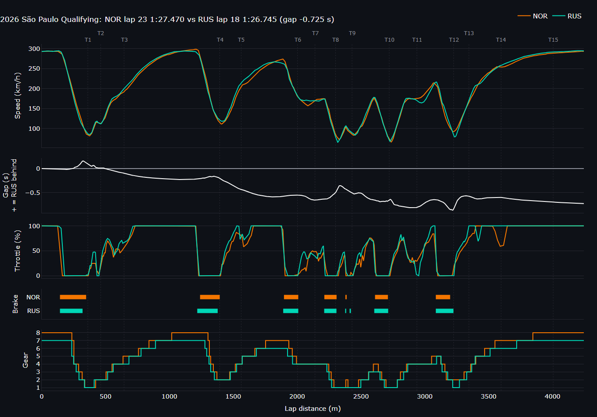
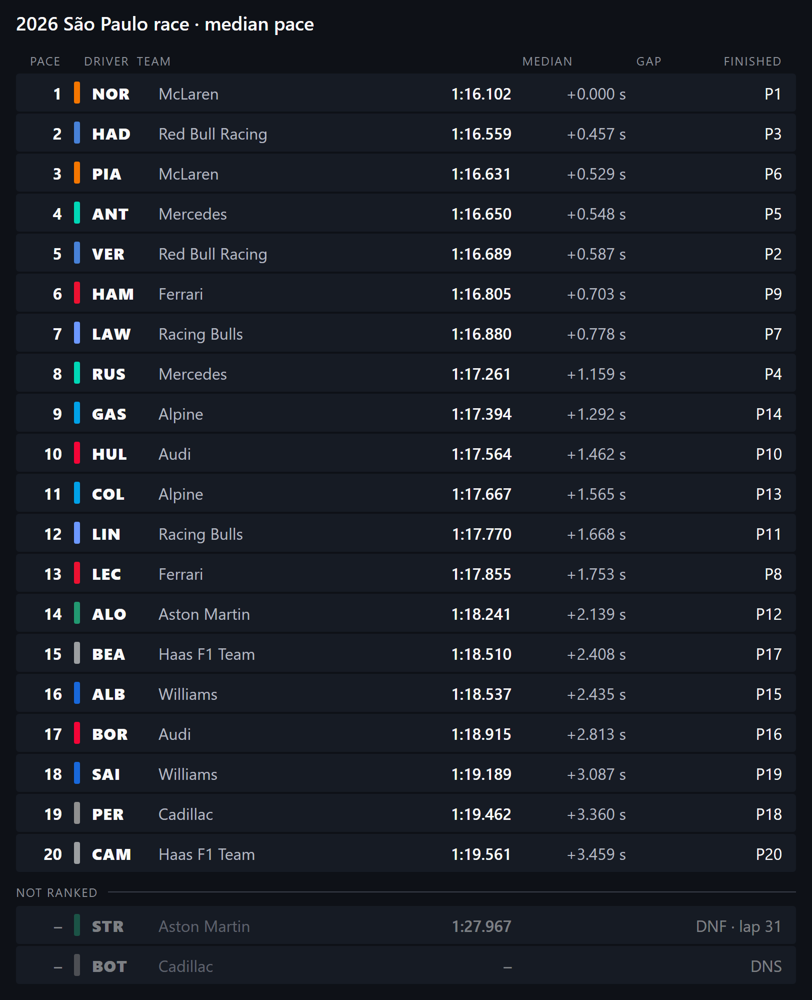
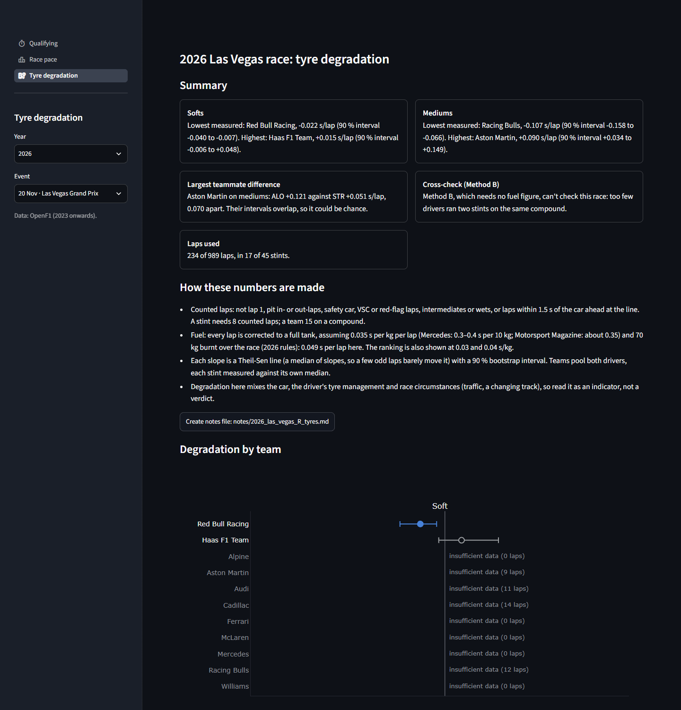
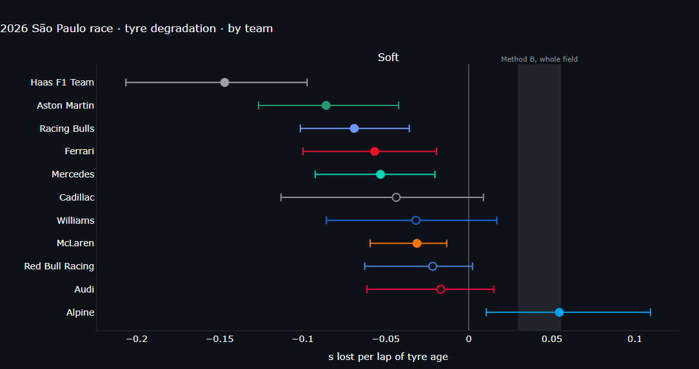

# Project Versailles: F1 qualifying telemetry, race pace, tyre degradation and lap replay

Compares two drivers' qualifying laps from real F1 telemetry and shows **where** one gains or loses time and the **likely reason**, corner by corner. A second page, **Race pace**, ranks every driver in a race by their median lap time over clean racing laps: who was actually fastest, as opposed to who finished where ([method below](#race-pace-method)). A third, **Tyre degradation**, estimates how much lap time each car lost per lap of tyre age, per compound ([method below](#tyre-degradation-method)). A fourth, **Lap replay**, replays two drivers' laps together on a large track map, like a live-timing screen, with the telemetry synced underneath ([how it works below](#lap-replay)).

**Live app: https://project-versailles.streamlit.app/** (any session from 2023 onwards; the app sleeps when unused, so the first visit can take a minute)


## Example: Norris vs Russell, 2026 São Paulo Grand Prix qualifying

Russell 1:26.745 (lap 18, in Q2), Norris 1:27.470 (lap 23, in Q3). Rain fell during the session. Each driver's fastest lap of the session is the default, shown below; with the app's **Part** picker set to Q3, both laps come from the same part and Norris is 0.204 s quicker.

```
1. [Traction/exit] NOR loses ~0.23 s at T9: up to 11 km/h slower after the apex.
2. [Braking]       RUS loses ~0.21 s at T8: min speed 7 km/h lower.
3. [Mid-corner]    NOR loses ~0.21 s at T4: brakes ~22 m later, min speed 7 km/h lower, exit speed 9 km/h lower.
4. [Mid-corner]    RUS loses ~0.16 s at T11: min speed 10 km/h lower.
5. [Traction/exit] NOR loses ~0.16 s at T10: up to 8 km/h slower after the apex.

By zone type: low-speed corners RUS by 0.415 s, medium-speed NOR by 0.009 s,
high-speed RUS by 0.100 s, straights RUS by 0.220 s (together: the 0.725 s lap gap).

Driver vs car (heuristic): the gap swings both ways corner by corner (NOR quicker in 5,
RUS in 9 of 14), which suggests driving differences rather than the car.
```

Speed (with corner numbers), time gap, throttle, brake and gear share one lap-distance axis, so zooming any of them zooms all five:



A track map colours 25 mini-sectors by the faster driver and labels every corner section and straight with who gained there and by how much. Each finding is reproducible from the terminal: `python analysis.py 2026 Brazil Qualifying NOR RUS`.

## Method

1. **Data.** Lap times, car telemetry (speed, throttle, brake, gear, RPM at ~4 Hz) and car position come from [OpenF1](https://openf1.org). Corner positions come from MultiViewer via [FastF1](https://github.com/theOehrly/Fast-F1). Laps deleted by race control are excluded from "fastest lap" (matched by the incident's clock time, because race control's lap numbers can disagree with the timing data), and count again if reinstated. Qualifying laps are tagged Q1, Q2 or Q3 from race control's part markers, so laps can be compared within the same part as the track evolves.
2. **Alignment.** Distance is speed integrated over time, which drifts a few metres per lap (4250 m vs 4241 m here). Both laps are stretched to a common length so each corner sits at the same metre for both drivers. Then each driver's elapsed time is interpolated onto a 1 m grid and subtracted. The gap is computed here, not with `fastf1.utils.delta_time`, and ends at exactly the lap-time difference.
3. **Zones.** A corner zone runs from where the drivers come off full throttle to where both are back on it. Linked corners split at the fastest point between them, so each corner keeps its own exit. Flat-out kinks stay part of the straight. Zones tile the lap, so their gaps add up exactly to the lap-time gap.
4. **Metrics per zone and driver.**
   - Corners: braking point, minimum speed and gear, full-throttle point, exit speed, time gained or lost.
   - Straights: entry speed, top speed, time, and whether speed **flattens or drops at full throttle before braking**. That is flagged as a *possible* energy-deployment limit, never as certain.
5. **Cause tags.** Each corner's loss is split at the apex.
   - Mostly before the apex: *Braking*.
   - After the apex, with a lower minimum speed and an exit-speed gap that didn't grow: *Mid-corner* (lost in the middle, carried out).
   - After the apex, with a growing gap: *Traction/exit*.
   - On straights: if the loser started the straight slower but wasn't slower at the top, the time is credited to the previous corner's exit (*Traction/exit*). Otherwise it's *Straight-line/deployment*.
6. **By zone type.** Like AWS F1 Insights' car performance breakdown: corners are grouped by minimum speed into low-speed (under 120 km/h), medium and high-speed (from 200 km/h), plus straights, with the time each driver gained in each group. The four add up to the lap gap.
7. **Driver vs car (heuristic).** A deficit that repeats on every straight (judged on top speed) or in every low-speed corner points to the car. A deficit that swings from corner to corner points to the driver. All wording is hedged.

Every threshold lives in one commented `CONFIG` block at the top of [`analysis.py`](analysis.py). The full walk-through is in [docs/HOW_IT_WORKS.md](docs/HOW_IT_WORKS.md).

## Race pace method

The **Race pace** page answers one question: *who was fastest over the race?* It ranks drivers by the **median of their clean racing laps** and shows how their lap times are spread. The interesting output is a gap between pace and result: 2026 São Paulo, Leclerc finished P8 but was 13th on pace; Gasly was 9th on pace but finished P14.



1. **Data.** Each OpenF1 endpoint is fetched once for the whole field, not once per driver: lap times (`laps`), tyre compound and age (`stints`), pit stops (`pit`, plus `is_pit_out_lap`), safety car, VSC and red flags (`race_control`), result and retirements (`session_result`).
2. **Remove laps that weren't racing:** lap 1, pit in- and out-laps, laps with no time, and any lap that overlaps a safety-car, VSC or red-flag period. Periods are matched to laps by clock time, like deleted laps. A period runs from "DEPLOYED", "RED FLAG" or "SESSION ABORTED" to the first restart message ("TRACK CLEAR", "VSC ENDING", "SESSION STARTED" or the chequered flag). The first of any kind, because messages go missing: 2026 Monza and Mexico City each have a safety car that never posts "IN THIS LAP". Checked on all 91 races since 2023.
3. **±2σ filter, per driver, one pass:** keep laps within 2 standard deviations of that driver's mean. Step 2 must come first: 40 racing laps at 75 s plus 10 safety-car laps at 110 s give σ = 14 s and a window up to 110.3 s, so the safety-car laps (and every bad racing lap) would survive.
4. **Pace = median** of the clean laps, ranked fastest first, with the gap to the fastest median. The median, so one slow lap left over can't drag it.
5. **Not ranked:** retirements, and drivers with fewer than 10 clean laps. They're listed below the ranking, greyed out, with the reason (`DNF · lap 31`) and their median for reference.
6. **No fuel correction, deliberately.** A finisher's laps run from full tank to empty, so their median lap sits near half fuel, the same for every finisher. A retirement only has heavy-fuel laps, which is why retirements aren't ranked.
7. **Summary:** the biggest over- and underperformer (finishing order against pace order, among ranked drivers), the largest and smallest teammate gap, and the most consistent driver by interquartile range: the spread of the middle half of their laps, so one odd lap can't decide it.

Two views: a TV-style timing tower (hover a row for clean laps and tyre strategy) and a box plot of every driver's clean laps, each lap a dot in its tyre's colour. Click a driver's name in either view to open every lap of their race in a new tab, counted or not: lap time, the three sector times, and why a lap didn't count (lap 1, pit in-lap, safety car, outside ±2σ…). Thresholds live in the `CONFIG` block of [`pace.py`](pace.py). `python pace.py 2026 Brazil` prints the same ranking and summary.

**Limits of the race pace method**
- **Wet or mixed races.** Laps on intermediates and slicks are pooled. 2026 São Paulo started and finished on intermediates, so every driver's laps spread over ~10 s, the 2σ step removes almost nothing (5 of 1,298 laps), and ranks partly reflect how many wet laps each driver did. Ranking on slick laps alone would change 17 of 21 ranks. The page shows a rain warning.
- **After a red-flag restart,** cars can follow the safety car for a lap or two with no race-control message. Step 1 can't see those laps. The 2σ filter removed 96 of the 98 in the three 2026 races with one (Monza, Mexico City, Monaco); two Monza laps of ~126 s survived and nudge those two drivers' medians.
- **Pace rank ignores strategy, traffic, damage and tyre age,** so the summary is worded as pointers, not verdicts.
- Race sessions only: no sprints or practice long runs yet.

## Tyre degradation method

The **Tyre degradation** page estimates how much lap time each car lost per lap of tyre age, per compound, with a 90 % interval on every number. How a car treats its tyres is a car trait (aero balance, suspension, setup window), but a lap time also carries the driver's tyre management and the race around them, so the page presents it as an **indicator, never a verdict**.



1. **Data.** The same OpenF1 downloads as race pace, once each for the whole field: `laps`, `stints`, `pit`, `race_control`, `drivers`. Stints are rebuilt from pit out-laps, because OpenF1's stint table was wrong for two drivers in the test races (Stroll in São Paulo, Lawson in Las Vegas); compounds and starting tyre ages come from OpenF1 in the same order, and those drivers are flagged "rebuilt from pit stops". **Gap to the car ahead** comes from the lap table itself: cars that finished the same lap, sorted by when they crossed the line. It matches OpenF1's `intervals` to a median of 0.06 s, has no missing laps, and saves a ~25,000-row download.
2. **Laps that count.** Not lap 1, pit in- or out-laps, safety car, VSC or red-flag laps, laps without a time, intermediate or wet tyres, or **laps within 1.5 s of the car ahead** (dirty air). A stint needs **8** counted laps.
3. **Tyre age** = the set's age at the start of the stint + laps since. Used sets start above zero.
4. **Fuel correction (Method A).** Cars get faster as fuel burns off, which hides degradation. Each lap gets back what the burnt fuel gave it: **0.035 s per kg per lap** (Mercedes: 0.3–0.4 s per 10 kg; Motorsport Magazine: ~0.35 s per 10 kg) × **70 kg** of race fuel (2026 rules) ÷ race laps. That's 0.035 s/lap over 71 laps (São Paulo) and 0.049 over 50 (Las Vegas). **This is an assumption, not a measurement**, so the team ranking is also shown at 0.030 and 0.040 s/kg. Within a stint the correction adds exactly the fuel figure to every slope, so it can't reorder stints, only shift them all.
5. **Slope per stint: Theil–Sen** (the median of the slopes between every pair of laps) in numpy. A lock-up or a backmarker lap 4 s slow barely moves it, where ordinary least squares would be pulled off (the tests show 0.09 s/lap of error from three such laps). **90 % interval** by bootstrap with a fixed seed. An interval that includes zero is "not distinguishable from flat"; negative slopes are kept and flagged, never clamped to zero.
6. **Team × compound.** Both drivers' laps pooled, each stint centred on its own median time **and median tyre age**, so a slower driver or an older set can't create a slope. Under **15** laps: "insufficient data", shown greyed, not hidden. Teammates are compared on the same compound: the fairest test, because the car is the same.
7. **Cross-check (Method B), with no fuel figure:** `lap time = pace[driver, compound] + lap effect[lap] + slope × tyre age`, fitted by least squares. The lap effects absorb fuel and track changes for the whole field. It only gives a number when enough drivers ran two stints on one compound; otherwise it says so.

**What the test races show.** São Paulo (wet, then drying) gives negative slopes for 10 of 11 teams on softs: the track gained grip faster than the tyres wore. Method B finds the whole field got 0.121 s faster per lap, against 0.035 for fuel, and puts softs at **+0.042 s/lap**. That disagreement is the finding: Method A read the drying track as tyres getting faster. Las Vegas ran in packs (532 of 989 laps within 1.5 s of the car ahead), so only 7 of 22 team × compound cells have enough laps, and Method B can't check it. On dry races with two-stop strategies (2026 Austin, Singapore, Zandvoort) the two methods agree on every compound, and Method B's field trend is close to the assumed fuel effect.



`python tyres.py 2026 Brazil` prints every table; `python charts.py 2026 Brazil tyres` saves the three charts in `output/`. Every number lives in the `CONFIG` block of [`tyres.py`](tyres.py).

**Limits of the tyre degradation method**
- **Fuel figure.** Borrowed from team and press sources that predate the 2026 cars, and it varies by track. Teams that start short of fuel burn less per lap than 70 kg ÷ race laps.
- **Track evolution.** Method A ignores it. A rubbering-in or drying track makes tyres look better than they are; Method B corrects for it only where it can be fitted.
- **Traffic.** Only the gap to the car ahead *in race order* is known, so a car held up by a backmarker counts as clean air. The 1.5 s rule also removes most laps in races run in packs.
- **Straight lines only.** No "cliff" detection: a tyre that falls away at the end of a stint is averaged into one slope.
- **Car or driver?** A steeper slope can be the car, a driver managing a gap, or a stint spent fighting. Teammate comparisons help, but can't separate them.
- Wet tyres are never fitted; race sessions only.

## Lap replay

Answers one question: **which part of the track is this bit of telemetry about?** Pick two laps (the same pickers as Qualifying; race laps work too) and press play.

- **Track map first:** a large map in the circuit's official orientation, with corner numbers on leader lines, sector ticks and a start/finish line. It's cut into 25 mini-sectors, each grey until both cars have passed it, then painted in the faster driver's colour.
- **Car markers** carry the driver number and follow each car's real timing from the line. Overlapping cars are pushed apart sideways, and each car stops on the line when its lap ends.
- **Sector strip:** each sector time appears as the car crosses that sector's line, and the faster one is highlighted. When both cars have finished, the lap result shows large ("ANT faster by 0.258 s").
- **Telemetry panel** (48 px below the map, in its own box): speed, throttle with brake bands, and the running gap, on one distance axis. The cursor follows the leading car.
- **Hover either way:** hover a trace and a ring marks that spot on the map; hover the map and the traces jump there, with every value read out.
- **Play, pause, scrub, 0.25× to 2× and the space bar** all run in your browser, inside a self-contained player (no CDN). They never re-run the Streamlit script.

Times come straight from OpenF1: the payload's lap and sector times match the official ones to the millisecond (checked on 2026 Las Vegas qualifying and race). The car-number font is Archivo (SIL Open Font License, in `assets/fonts/`); see `assets/README.md` to swap in a licensed team font.

## Limitations

- **One lap proves nothing on its own.** Findings describe *this* lap; traffic, tyre preparation or a mistake can dominate.
- **Resolution.** OpenF1 car data is ~4 Hz: one sample every ~20 m at 300 km/h. Braking and throttle points are interpolated to about ±10 m, so differences under 15 m (or 3 km/h) aren't reported.
- **Brake is on/off only.** There's no pressure channel, so trail-braking and brake modulation are invisible.
- **2026 cars.** There's no DRS or active-aero channel, so straight-line findings can't separate aero mode from energy deployment, and there's no energy or battery data.
- **Corner positions are approximate** (MultiViewer), and thresholds were tuned on a wet session. Expect to revisit them for dry running.
- **Data coverage:** 2023 onwards (OpenF1). F1's own live-timing archive now requires an F1 TV subscription, which is why FastF1's session loader isn't used for telemetry.
- **Lap replay positions** are drawn on one track line (the faster lap's), so the two cars' racing lines aren't shown, only where each car was along the lap. Sector lines are placed from the faster lap's sector times, since OpenF1 doesn't give their positions.
- **Rate limits.** OpenF1's free tier allows 30 requests a minute, shared by every visitor of the hosted app. Responses are cached for 10 minutes and rate-limited requests are retried.

## Run it locally

Requires Python 3.12.

```bash
git clone https://github.com/plamenroudevski/project-versailles.git
cd project-versailles
python -m venv .venv
.venv\Scripts\activate          # Windows; on macOS/Linux: source .venv/bin/activate
pip install -r requirements.txt
streamlit run app.py
```

Terminal tools: `python analysis.py` (zone table and findings), `python charts.py` (HTML charts in `output/`), `python check_session.py` (which channels a session provides). Each takes `YEAR PLACE SESSION A B`, e.g. `2026 Brazil Qualifying NOR RUS`. For race pace, give just `YEAR PLACE`: `python pace.py 2026 Brazil` (ranking and summary), `python charts.py 2026 Brazil` (timing tower and box plot in `output/`). For tyre degradation: `python tyres.py 2026 Brazil` (every table) and `python charts.py 2026 Brazil tyres` (three charts in `output/`). For the lap replay: `python replay.py 2026 "Las Vegas" Qualifying ANT VER` checks the payload's times against OpenF1's and writes a standalone player to `output/` (add two lap numbers for other laps, e.g. `... Race ANT VER 43 50`).

**Your own notes:** add Markdown files in `notes/` (the app creates an empty one with one click when run locally). They show under the findings, and online once committed. Race pace notes use `pace` in place of the driver pair, e.g. `notes/2026_sao_paulo_R_pace.md`, and tyre notes use `tyres`: `notes/2026_sao_paulo_R_tyres.md`.

## Project layout

| File | Role |
|---|---|
| [`data.py`](data.py) | Fetching and caching (OpenF1, MultiViewer), deleted laps, race and tyre lap tables, notes files |
| [`analysis.py`](analysis.py) | The qualifying analysis engine: pure functions, runnable from a script |
| [`pace.py`](pace.py) | The race pace engine: pure functions on a plain lap table, runnable from a script |
| [`tyres.py`](tyres.py) | The tyre degradation model: pure functions on a plain lap table, runnable from a script |
| [`replay.py`](replay.py) | The lap replay's data: one JSON payload (laps on a 1 m grid, sectors, corners, rotated map) poured into the player |
| [`replay_player.html`](replay_player.html) | The lap replay player: SVG map, canvas traces and the animation loop, in one self-contained file |
| [`assets/`](assets) | Files the player embeds: the car-number font and its licence |
| [`charts.py`](charts.py) | Plotly figures, the race pace timing tower (HTML) and the tyre charts |
| [`app.py`](app.py) | Streamlit user interface only: the Qualifying, Race pace, Tyre degradation and Lap replay pages |
| [`check_session.py`](check_session.py) | Reports which telemetry channels a session actually has |
| [`tests/`](tests) | pytest, using made-up laps with hand-checked answers |

Run the tests with `python -m pytest`.

## Next (out of scope for v1)

- Live timing
- Tyre "cliff" detection; sprint and practice long-run pace and degradation
- Comparing more than two drivers
- User accounts
- Databases

## Credits

Data: [OpenF1](https://openf1.org). Corner positions: [MultiViewer](https://multiviewer.app) via [FastF1](https://github.com/theOehrly/Fast-F1). This is an unofficial project, not associated with Formula 1 or any team.
