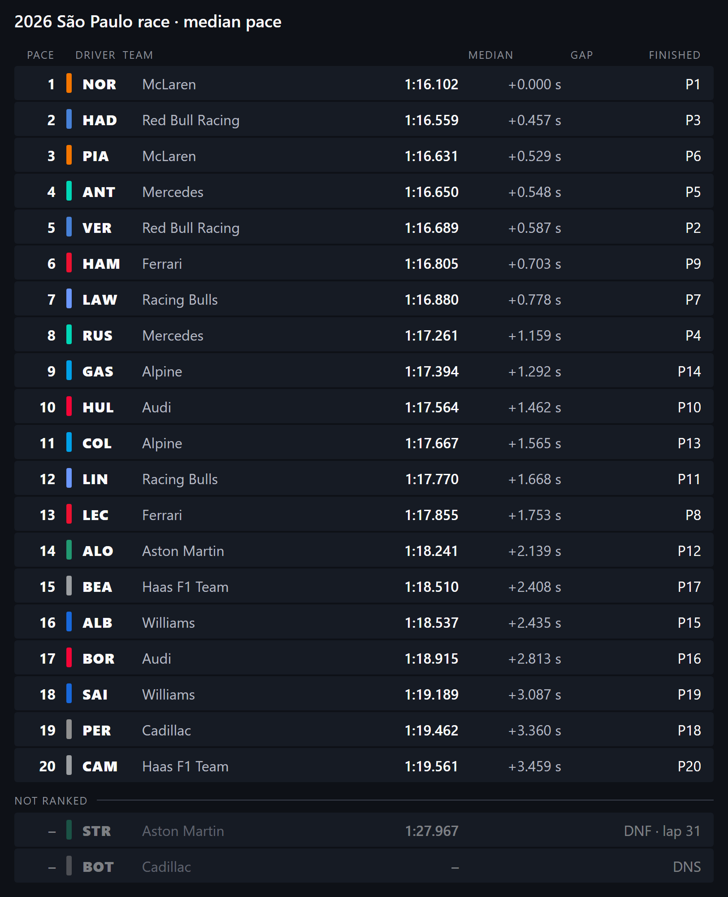

# How it works

Your revision guide: the whole pipeline from raw data to findings, the reasoning behind each choice, and the questions you're likely to be asked. Numbers come from the acceptance test: **Norris vs Russell, 2026 São Paulo qualifying** (wet). The race pace page has its own section, [9. Race pace method](#9-race-pace-method-pacepy), tested on the **2026 São Paulo race**.

## The 30-second version

> "It takes two qualifying laps, puts them on a common distance axis and computes the time gap metre by metre. It cuts the lap into corners (from lift to full throttle) and straights, and measures each driver in each zone: braking point, minimum speed, throttle pickup, exit speed, top speed. Then it ranks where the time went and tags a likely cause (braking, mid-corner, traction, or straight-line/deployment) with the evidence. A last heuristic asks whether the deficits look like the car (repeating everywhere) or the driver (varying corner to corner). It's all hedged, because one lap can't prove cause."

## The pipeline

```
OpenF1 (laps, telemetry, position, weather, race control,    MultiViewer via FastF1 (corner positions)
        stints, pit, session result)
                         \                                    /
                          data.py      fetch, cache, tidy into tables
                             |
          analysis.py  align -> corners -> zones -> metrics -> findings -> car/driver read   (qualifying)
          pace.py      racing laps -> 2-sigma filter -> median, rank, gap -> summary           (race pace)
                             |
                          charts.py    Plotly figures, the race pace timing tower
                             |
                          app.py       Streamlit pages (UI only): Qualifying, Race pace
```

Each file only talks to the one before it. `analysis.py` and `pace.py` have no downloads and no Streamlit, which is what makes them testable with made-up laps.

## 1. Getting the data (`data.py`)

- **Why OpenF1, not FastF1's loader:** F1's live-timing archive, which FastF1 reads, now returns *401 Unauthorized* without a paid F1 TV login. OpenF1 serves the same ~4 Hz car data for free, from 2023 onwards. FastF1 is still used for corner positions (from MultiViewer).
- **Channels:** speed, throttle (0–100 %), brake (**on/off only**), gear, RPM, plus X/Y position. For 2026 cars, **DRS is empty**, because active aero replaced it and isn't in the feed.
- **Deleted laps:** race control posts text such as `CAR 18 (STR) TIME 1:42.680 DELETED ... LAP 4 16:29:11`. Its "LAP 4" was OpenF1's lap 3, an off-by-one in this session. So the code ignores lap numbers and uses the **incident's clock time** (16:29:11 local → UTC) to find the lap being driven at that moment. It also handles sessions that run past midnight. A lap given back after review (`CAR 44 (HAM) TIME 1:20.755 WILL BE REINSTATED`) names its lap time instead of a clock time, so it's matched by lap time and counts again.
- **Qualifying parts (Q1/Q2/Q3):** race control tags every message with its part and posts "SESSION STARTED" as each part begins, and again after a red flag. Each lap gets the part that most recently started before the lap began. Gaps between laps would be fooled by red flags: 2026 São Paulo's Q1 was red-flagged two minutes in and restarted 84 minutes later. It matters for analysis because the track changes between parts. Russell's fastest lap was in Q2, Norris's in Q3, and Q3 against Q3, Norris was 0.204 s quicker.
- **Rate limits and caching:** OpenF1's free tier allows 3 requests/s and 30/min. A "429 Too Many Requests" reply is retried after 2, 5, 15, then 40 s. Answers are cached on disk for 10 minutes with requests-cache (the library FastF1's own cache is built on): short enough that a just-finished session corrects itself, long enough to absorb bursts. FastF1's request helper isn't used for OpenF1 because it has a hidden cap of 500 downloads per hour, shared by every visitor of the hosted app, and raises an error past it (found in an audit).

### Building the telemetry table
- **Padding:** fetch 2 s either side of the lap. Samples never land exactly on the line, so we need one on each side to interpolate between.
- **Position** is sampled at different moments from car data, so it's interpolated onto the car-data timestamps.
- **Distance = speed integrated over time** with the trapezium rule: each step adds (average of two speeds) × (time step). Then the whole column is shifted so that the moment the lap starts (time 0) is exactly 0 m.

## 2. Aligning the two laps (`align_laps`)

The two cars' samples are taken at different places, so you can't subtract row by row. The question becomes: *how long had each car been driving when it reached each metre?*

1. **Stretch.** Integrated distance drifts: 4250 m (NOR) vs 4241 m (RUS). Both laps are scaled to the average, so T1 is at the same metre for both. Without this, a 9 m drift by the end of the lap would look like a braking-point difference.
2. **Grid.** One point every 1 m from 0 m to the finish.
3. **Interpolate** each driver's time (and speed, throttle, position) onto the grid with `np.interp`.
4. **Delta = B's time − A's time** at every metre. Because time 0 = 0 m and lap time = finish line, the delta starts at exactly 0 and ends at exactly the lap-time gap (−0.725 s here).

**The brake trick:** brake is 0/1. Interpolated, it ramps from 0 to 1 between the last "off" and first "on" sample, and the 0.5 crossing is the halfway point. That halves the location error compared with "first sample that says on". At 300 km/h a sample comes every ~20 m, so the estimate is good to about ±10 m.

**Gear** takes the last sample's value instead (no "4.5th gear").

## 3. Corners and zones (`locate_corners`, `split_zones`)

- **Corner distances:** MultiViewer gives each corner's X/Y. The code finds the grid point where the car passed closest to it. One lap is used, because averaging two laps could put a marker near the start line in the middle of the lap (5 m and 4245 m average to 2125 m).
- **Flat-out kinks** (both drivers at full throttle, off the brake within 50 m of the marker) are dropped. They're part of the straight (T15 at Interlagos).
- **A corner zone = lift to full throttle.** It runs from the earlier driver's last full-throttle point before the apex to the later driver's first full-throttle point after it, so it contains both drivers' entire braking zone and exit.
  - *Why not a fixed window?* The first version used "200 m before the marker". On this wet lap, braking for T1 started 215 m before the marker, so the braking point was cut off. Fixed windows also pull straight-line time into corners.
- **Linked corners** (no full throttle between them, e.g. T7→T8→T9) **split at the fastest point between them**, where one exit ends and the next braking begins. Splitting halfway between markers had handed part of Russell's stronger T8 exit to "Norris loses time braking into T9", even though they braked at the same point.
- **Short gaps** (< 150 m) between corners are shared; longer gaps are straights.
- **Self-check:** the zones cover every metre exactly once, so their gaps sum to the lap gap. `analysis.py` prints this check.

## 4. Metrics (`corner_metrics`, `straight_metrics`)

| Corners | Straights |
|---|---|
| Braking point (first brake-on, if the zone started off the brake) | Entry speed (carried from the previous exit) |
| Minimum speed, its position (apex) and gear | Top speed (measured up to the next corner marker) |
| Full-throttle point after the apex (throttle ≥ 95 %) | Deployment pattern: speed *drops* ≥ 3 km/h, or *flattens* (< 1 km/h gain over the last 150 m), at full throttle |
| Exit speed (at the zone end) | Time gained or lost |
| Time gained or lost, split before and after the apex | |

**Deployment is always "possible"**: a drag-limited car also flattens, and there's no energy channel to confirm it.

## 5. Findings and causes (`rank_findings`)

Zones are ranked by time lost (≥ 0.02 s, top 5). For a corner, the loss is split at the apex (average of both drivers' minimum-speed points):

- **Braking**: most of the loss came before the apex (braking, turn-in).
- **Mid-corner**: the loss came after the apex, the loser was already slower at the apex, and the exit-speed gap is no bigger than the apex gap. The time was lost in the middle and carried down the exit.
- **Traction/exit**: the loss came after the apex and the speed gap *grew* on the way out.

**Straights:** time on a straight is mostly decided by the speed you enter with. If the loser entered slower but wasn't slower at the top, it's really the previous corner's **Traction/exit**; otherwise it's **Straight-line/deployment**.

**Evidence** lists only differences above the noise thresholds (15 m, 3 km/h). When nothing crosses them, which is common in the wet because nobody reaches full throttle, the finding says where the speed went instead: "up to 11 km/h slower after the apex" (Norris at T9, where Russell was on 40–57 % throttle against Norris's 19–39 %).

## 6. Driver vs car (`driver_vs_car`), a heuristic

- **Repeats everywhere → car.** A lower top speed on *every* straight, or losing in *every* low-speed corner (minimum speed < 120 km/h): a driver's mistakes rarely repeat that neatly.
  - Straights are judged on **top speed, not time**. Norris "lost time on all straights" here but had the *higher* top speed on two of them; the time came from weaker corner exits.
- **Swings corner to corner → driver.** The car is the same car in every corner. Brazil: NOR quicker in 5 corners, RUS in 9.
- **One-sided (e.g. 11 to 1) → can't tell:** either overall grip or a consistent driving difference. A "swing" needs the less successful driver to win at least 25 % of the corners.

### By zone type (`type_breakdown`)

Like AWS F1 Insights' car performance scores: every zone is a low-speed corner (minimum speed under 120 km/h, averaged over both drivers), a medium-speed corner, a high-speed corner (from 200 km/h) or a straight. Each group's zone times are summed. The bands are rough conventions (AWS doesn't publish its cut-offs) and live in CONFIG. The four sums add up to the lap gap, because the zones cover the lap exactly once. Brazil, whole-session laps: Russell gained 0.415 s in low-speed corners and 0.220 s on straights, and the medium-speed corners were level. The same bands define "low-speed corners" in the car/driver read, so the two can't disagree.

## 7. Charts and app

- **One Plotly figure with five rows sharing an x-axis.** That's the only way zoom stays in sync, because separate Streamlit charts can't talk to each other.
- **Brake lanes:** on/off signals for two drivers would hide each other as lines, so each driver gets a lane with bars. OpenF1's brake channel is only 0 or 100 (no pressure), so there's no brake % to show. The bars have gaps, and Plotly's hover borrowed the nearest bar point a few metres away, reporting "braking" for a driver who hadn't braked yet. So an invisible line with a value at every metre carries the hover ("brake on/off") instead.
- **Track map labels:** each corner label adds who gained in that corner section and by how much (its zone time), in that driver's colour, and each straight gets the same note halfway along. Flat-out kinks have no zone, so their labels stay plain.
- **Colours:** team colours unless they look too alike or too dark. "Alike" is measured as a perceptual colour difference (CIE Lab ΔE ≥ 30) for normal vision *and* simulated deuteranopia. "Too dark" means WCAG contrast below 3:1 against the background. Otherwise a colour-blind-safe orange/blue pair is used.
- **Streamlit re-runs the whole script** on every click. `@st.cache_data` remembers results per input for 10 minutes, so re-runs are instant.
- **Notes:** plain Markdown in `notes/`, named by session and sorted driver pair. The create button only appears on localhost, because the hosted app's disk is wiped on restart.

## 8. Testing

`tests/` uses **made-up laps with hand-checkable answers**, generated at 4 Hz like the real data:

| Test | What it proves |
|---|---|
| Constant speeds 180 vs 144 km/h | Gap is 2.5 s at 500 m and 5.0 s at the line |
| Same lap with distance 1 % short | Stretching removes integration drift (gap = 0) |
| Brake switches on between samples at 592.5 and 605 m | Braking point lands halfway (598.75 m) |
| Hand-built lap with linked corners and a kink | Zone boundaries exactly as worked out on paper |
| Car B brakes 20 m earlier | End-to-end: "B loses at T1 [Braking], brakes earlier", and zone gaps sum to the lap gap |
| Straights that drop, flatten or keep climbing, each after an early lift | The deployment flag, judged on the last flat-out run |
| Raw OpenF1-style tables for a steady 180 km/h | Distance is 0 m at the line and 400 m after 8 s |
| Real race-control messages, a lap past midnight, a reinstated lap | Deleted laps found by clock time, reinstated ones by lap time |

## 9. Race pace method (`pace.py`)



### The 30-second version

> "For every driver in a race, it throws away the laps that weren't racing: lap 1, pit laps, anything under a safety car, VSC or red flag. Then it trims each driver's outliers with a 2-sigma filter, takes the median of what's left as their pace, and ranks on it. Retirements aren't ranked, because their laps are all on heavy fuel. The interesting output is where pace and result disagree: in São Paulo, Leclerc finished P8 but was 13th on pace. It's hedged, because pace ignores strategy, traffic and damage."

### The lap table: a plain format on purpose

`pace.py` reads one row per driver per lap: `driver, lap, lap_time_s, compound, tyre_age, pit_in, pit_out, neutralised`. Nothing in it is OpenF1-specific, so lap data from an AiM or MoTeC logger could be fed in the same way. `data.build_race_laps` makes it from OpenF1:

- **One request per endpoint for the whole field** (`laps`, `stints`, `pit`, `race_control`, `session_result`, `drivers`): about 8 requests per race. The free tier allows 30 a minute for every visitor together, so 22 drivers × 5 endpoints would not do.
- **Tyres:** `stints` gives one row per set (laps `lap_start` to `lap_end`), spread over its laps. Tyre age = laps the set had done when the lap began (`tyre_age_at_start` + laps since the stint started), as OpenF1 counts it. A stint still running has no `lap_end`. No tyre data → the compound stays empty and shows as "Unknown": never guessed.
- **Pit laps:** an in-lap is a lap the `pit` endpoint names, *or* the lap before an out-lap (`is_pit_out_lap`). The second rule covers a stop the pit endpoint misses. In São Paulo both sources agreed for every driver.
- **Neutralised laps** (`neutralised_periods`): race control posts when a safety car, VSC or red flag starts and ends. A lap is neutralised if it overlaps a period at all, by clock time, the same idea as deleted laps.
  - Starts: "SAFETY CAR DEPLOYED", "VSC DEPLOYED" ("VIRTUAL SAFETY CAR DEPLOYED" before 2026), "RED FLAG", "SESSION ABORTED". 2026 red flags only post "SESSION ABORTED".
  - Ends: the **first** of "TRACK CLEAR" (or a green light) for the whole track, "VSC ENDING", "SESSION STARTED", the chequered flag.
  - *Why the first end message of any kind:* messages go missing. 2026 Monza and Mexico City each have a "SAFETY CAR DEPLOYED" with no "SAFETY CAR IN THIS LAP" (both turned into red flags), and 2023–25 have 75 "VSC DEPLOYED" but only 53 "VSC ENDING". Waiting for the matching message would neutralise the rest of the race.
  - *Why not "SAFETY CAR IN THIS LAP":* the safety car is still out until the restart a lap later, which "TRACK CLEAR" marks.
  - Run on all 91 races since 2023: 120 periods, every one closes. The only one left open is 2023 Melbourne's final red flag, a race that did finish behind the safety car.
- **Results** (`build_results`): `session_result` gives position, laps completed and DNF/DNS/DSQ flags. It exists for every race since 2023 that ran (the three without one were cancelled), so there's no fallback, just a "try again" message for a race that has only just finished.

### Step 1: remove laps that weren't racing (`racing_laps`)

Lap 1 (standing start, in traffic), pit in- and out-laps (part of the lap is the pit lane), neutralised laps, laps with no time. São Paulo: 1,437 laps → 1,298 racing laps.

### Step 2: ±2σ per driver, one pass (`sigma_filter`)

Keep each driver's laps within 2 standard deviations of *their own* mean.

- **Why step 1 must come first:** a neutralised lap is 30–50 % slower. 40 racing laps at 75 s plus 10 safety-car laps at 110 s have a mean of 82 s and σ = 14.1 s, so the window runs from 53.7 to 110.3 s and keeps the safety-car laps. A window that wide also keeps every genuinely bad racing lap. The test case: ten laps 80.0–80.9 s, a mistake at 84.0 s and four 110 s safety-car laps. Right order: median 80.45 s (84.0 cut). Wrong order: 80.5 s (84.0 survives).
- **Why per driver:** a lap that's normal for a slow car is an outlier for a fast one (83.0 s is cut for a driver lapping 80.0–80.9, kept for one lapping 86–95).
- **Why one pass:** repeating it keeps tightening the window and starts eating genuine laps.
- **Sample standard deviation** (dividing by n − 1, pandas' default): the laps are a sample of the driver's pace.

### Step 3: pace, rank, gap (`classify`)

- **Pace = median** of the clean laps, not the mean: one slow lap left over can't drag it.
- **Rank** fastest first; equal medians share a rank (2026 Las Vegas: Leclerc and Sainz both 6th on 1:37.926).
- **Gap** = median − fastest ranked median, shown as `+0.457 s`.
- **Not ranked:** retirements (`DNF · lap 31`: retired on the lap after the last one completed), non-starters (`DNS`), and finishers with fewer than 10 clean laps. Listed below a divider with their median, for reference only. A disqualified driver did race the distance, so is ranked and shown as "DSQ".
- **No fuel correction, deliberately.** Fuel costs lap time and burns off through the race. A finisher's laps run evenly from full to empty, so their median lap sits near half fuel: every finisher is compared at a similar load, and the effect cancels out of the ranking. A retirement only has heavy-fuel laps, so their median looks slower than their real pace: that's why they aren't ranked.

### Step 4: summary (`summarise`)

- **Over/underperformer:** finishing order against pace order, both counted among the same drivers (ranked, with a finishing position), so a retirement up the road doesn't count as a place gained. São Paulo: Leclerc +5 (P8, 13th on pace), Gasly −5 (9th on pace, P14).
- **Teammate gaps:** teams with both drivers ranked. Largest: Audi, 1.351 s. Smallest: Red Bull, 0.130 s.
- **Most consistent:** smallest interquartile range (75th minus 25th percentile of clean laps). Unlike the standard deviation it ignores the slowest and fastest quarter, so one odd lap can't decide it.
- Every sentence is hedged ("may explain", "pointers, not verdicts"): pace rank ignores strategy, traffic and damage.

### Charts and the page

- **Timing tower: HTML, not a Plotly table.** A Plotly table can't draw a coloured bar in a row or show a tooltip per row, and looks like a spreadsheet. All text from the data goes through `html.escape` and team colours are checked against `#RRGGBB`, so data can't inject HTML or CSS. The tooltip (clean laps, `I → S → S → I`) shows on hover *and* on keyboard focus: every row (in the app, its driver link) can be tabbed to, and screen readers read the tooltip text.
- **Box plot:** one box per driver in classification order, team colours, outlier markers off (every clean lap is drawn as a dot anyway). Dots are jittered sideways with a **fixed random seed**, so they don't jump on every re-run. Pirelli colours plus a **marker shape per compound**, because soft red and intermediate green look alike to deuteranopes, and São Paulo had both. The y-axis labels are made in code (`1:16.0`), because Plotly can only format plain numbers.
- **Driver laps screen:** a driver's name in either view is a link to a third page, `/driver?race=11412&driver=NOR`, opened in a new tab so the Race pace tab keeps its race. It lists every lap, counted or not: lap time, sectors 1–3 (from OpenF1's `duration_sector_1..3`) and the reason a lap didn't count (`pace.why_not_counted`, which follows steps 1 and 2 in order, so a first lap under a safety car says "Lap 1"). The page isn't in the sidebar (`visibility="hidden"`), and it reuses the cached race, so opening it costs no downloads. The race and driver come from the address, which anyone can type, so a race key that isn't a number, or a driver not in the race, gets a "click a driver's name" message, and the address's text is never shown unchecked.
- **Two pages with `st.navigation`**, not a page selector: each page has its own address (`/`, `/race-pace`) and its own sidebar, and only the open page's code runs. The pages are functions in `app.py`, sharing the cached helpers. The finished race-pace result is cached per race, so switching views costs nothing.

### Tests

| Test | What it proves |
|---|---|
| Laps 1, an in-lap, an out-lap, a safety-car lap, a lap with no time | Step 1 drops exactly those |
| 80.0–80.9 s, a mistake at 84.0 s, four 110 s safety-car laps | Right order gives a median of 80.45 s, wrong order 80.5 s |
| The same 83.0 s lap for a fast and a slow driver | The 2σ filter is per driver |
| Twelve identical laps at 80.0, 80.25, 81.0 s | Ranks 1-2-3, gaps 0, 0.25, 1.0 s |
| A fast retiree, a finisher with 5 clean laps, a non-starter | Not ranked, with the right reason; gaps measured from the fastest *ranked* driver |
| Laps spread evenly around set medians | Over/underperformer, teammate gaps, IQR = the spread set |
| Real 2026 Mexico City and Kuala Lumpur race-control messages | Periods close at the restart, survive missing messages, VSC → SC is one period |
| A tiny OpenF1-style race | Tyre age, open stints, in-laps the pit endpoint missed, neutralised laps |

### Honest weaknesses of race pace

- **Wet or mixed races.** Intermediate and slick laps are pooled. São Paulo started and finished on intermediates, so every driver's laps spread over ~10 s, the 2σ step removed only 5 of 1,298 laps, and "most consistent" reads 10.3 s. Ranking on slick laps only would change 17 of 21 ranks. The rain warning shows, but the ranking partly reflects how many wet laps each driver did.
- **After a red-flag restart,** cars can follow the safety car for a lap or two with no message at all (2026 Monza, Mexico City, Monaco). Step 1 misses them. They're 10–130 % slower, and the 2σ filter removed 96 of the 98 in those races; Alonso's and Stroll's lap 6 at Monza (~126 s against ~85 s) survived, because those two drivers' laps were spread widely enough to stretch their windows.
- **No tyre-age or traffic correction:** a driver who spent the race in dirty air, or on older tyres, looks slower than their car was.
- **The median hides strategy:** a driver on a one-stop and a two-stop are compared as if on the same plan.

### Questions you might be asked

- **Why the median, not the mean?** One slow lap that survives the filter barely moves a median but drags a mean.
- **Why not correct for fuel?** For finishers it cancels out: everyone's median lap is near half fuel. For retirements it wouldn't, so they're not ranked instead of being corrected with a guessed fuel effect.
- **Why remove safety-car laps before the 2σ filter?** They inflate σ so much that the window swallows them, and every bad racing lap with them. Worked example in Step 2.
- **Why 2σ and not 3σ, or an iterative filter?** For roughly normal lap times, ±2σ keeps ~95 %: it trims mistakes and traffic laps without cutting into normal running. Iterating keeps tightening the window. The value lives in `CONFIG`, so it's easy to try another.
- **Why the IQR for consistency?** The standard deviation squares every deviation, so one odd lap dominates it. The IQR only looks at the middle half.
- **Why compare finishing order among ranked drivers only?** Otherwise a retirement ahead of you counts as a place you "gained" against your pace.
- **How do you know the safety-car mapping works?** Ran it on all 91 races since 2023 and listed every period over 15 minutes without a red flag, or never closed: all were genuine long safety cars, plus 2023 Melbourne's finish under the safety car.
- **What would you add with more data?** A tyre-degradation slope per stint, a fuel-effect model to compare retirements fairly, a rule to rank wet races on one tyre type, and practice long runs.

## Honest weaknesses (say these before they're asked)

- **One lap, wet session:** the thresholds were tuned on it, and dry running may need different values.
- **4 Hz and on/off brake:** no trail-braking or brake-pressure analysis. Sub-15 m differences are invisible.
- **No energy data for 2026:** deployment can only be inferred from the speed shape.
- **Cause tags are rules, not models:** they explain where on the corner time went, not why the car or driver did it.
- **Corner positions are approximate**, so a zone can include a bit of the neighbouring straight.

## Questions you might be asked

- **Why not subtract the two traces sample by sample?** The samples are at different places on track. You need a common axis, distance, and interpolation.
- **Why distance and not time on the x-axis?** Corners are fixed in distance. On a time axis, the faster car reaches T1 earlier and the traces drift apart.
- **How accurate is a braking point?** About ±half a sample gap: ±10 m at 300 km/h. Hence the 15 m reporting threshold.
- **How do you know the delta is right?** It ends at exactly the official lap-time gap, the zones sum to it, and a synthetic test checks it against hand calculation.
- **Why might "time lost on a straight" mislead?** It's mostly exit speed carried from the previous corner. Judge the car on top speed and on the speed *shape* at full throttle.
- **Why not split Q1/Q2/Q3 by the gaps between laps?** Red flags make gaps too (an 84-minute one inside Q1 in São Paulo). Race control's own part markers are exact.
- **What would you add with more data?** Brake pressure for trail-braking, steering angle for understeer vs oversteer, energy state for 2026 deployment, and several laps per driver to separate repeatable traits from one-offs.
- **What surprised you?** F1 put its timing archive behind a login, race control's lap numbers were off by one, and in the wet nobody reached full throttle in some corners, so throttle-point metrics went blank and I needed a fallback.

## Python worth being able to explain

- **`np.interp(x, xp, fp)`**: linear interpolation. "Given known points (xp, fp), what's the value at x?" It's used for every resample.
- **`DataFrame.loc[...]` and `idxmin()`**: select rows by label or condition; `idxmin` gives the row label of the minimum (the apex).
- **Decorators (`@st.cache_data`)**: a line above a function that wraps it with extra behaviour, here memoising results.
- **`**params`**: collects keyword arguments into a dictionary (turned into URL filters in `data.openf1`).
- **Opening a file with mode `"x"`**: create the file, and fail if it exists, so notes can't be overwritten.
- **Regular expressions** (`data.DELETED_LAP`): a pattern that pulls the driver code and clock time out of race-control text.
- **`groupby("driver")[...].transform("mean")`** (`pace.sigma_filter`): works out each driver's mean and puts it on every one of their rows, so each lap is compared with its own driver's numbers. `agg` would give one row per driver instead.
- **`Series.quantile(0.75)`**: the value 75 % of the way through the sorted laps, interpolating between two laps if needed. IQR = `quantile(0.75) - quantile(0.25)`.
- **`np.random.default_rng(0)`**: a random-number generator with a fixed seed, so the "random" jitter is the same on every run.
- **`html.escape`**: turns `<`, `>`, `&` and quotes into safe codes, so text from the data can't become HTML.
- **`st.navigation([st.Page(...), ...]).run()`**: Streamlit's multipage navigation; each `st.Page` here wraps a function, and `.run()` calls the open one.
